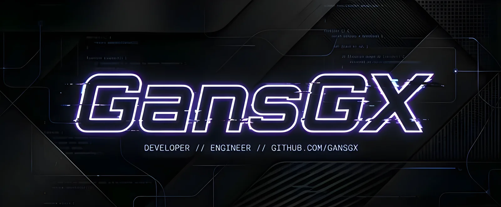
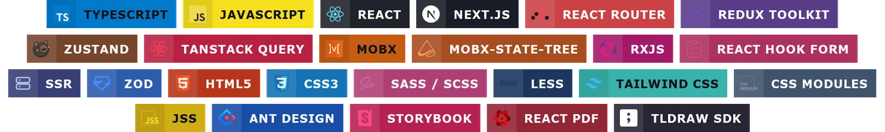
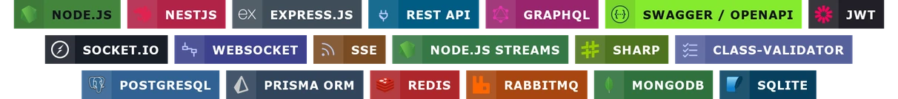
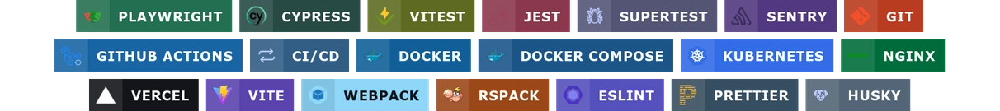
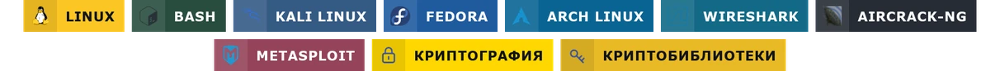

<picture>
  <source media="(max-width: 575px)" srcset="https://raw.githubusercontent.com/GANSGX/GANSGX/main/assets/profile-banner-800.webp">
  
</picture>

<strong>Привет! Я Вадим 👋 — fullstack-разработчик с мышлением инженера.</strong>

  Разрабатываю веб-приложения целиком. Собираю интерфейсы на React и Next.js, проектирую API на Node.js и NestJS, работаю с PostgreSQL и Redis.

  Мне нравится докапываться до сути технологий и понимать, как всё работает «под капотом». Помимо веб-разработки, интересуюсь компьютерными сетями и информационной безопасностью.

## ⚡ Инженерный стек

<h3 align="center">🌐 Frontend Development &amp; UI</h3>

  <picture>
    <source media="(max-width: 575px)" srcset="https://raw.githubusercontent.com/GANSGX/GANSGX/main/assets/skill-groups/frontend-phone.webp">
    
  </picture>

<h3 align="center">⚙️ Backend &amp; Databases</h3>

  <picture>
    <source media="(max-width: 575px)" srcset="https://raw.githubusercontent.com/GANSGX/GANSGX/main/assets/skill-groups/backend-phone.webp">
    
  </picture>

<h3 align="center">🛠 DevOps, Cloud &amp; Tools</h3>

  <picture>
    <source media="(max-width: 575px)" srcset="https://raw.githubusercontent.com/GANSGX/GANSGX/main/assets/skill-groups/devops-phone.webp">
    
  </picture>

<h3 align="center">🔒 Cybersecurity &amp; IT Infrastructure</h3>

  <picture>
    <source media="(max-width: 575px)" srcset="https://raw.githubusercontent.com/GANSGX/GANSGX/main/assets/skill-groups/security-phone.webp">
    
  </picture>

## 📊 Активность на GitHub

  

