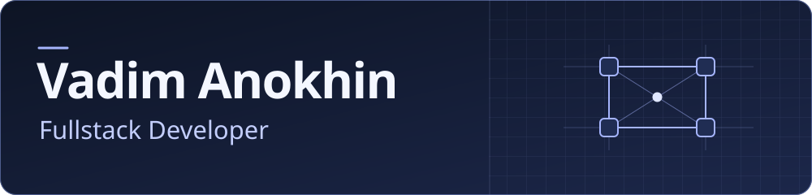
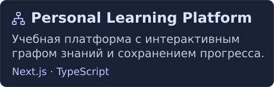
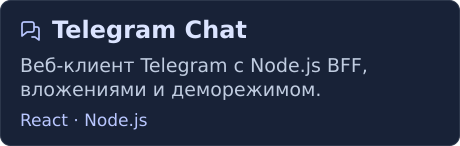
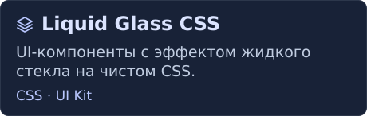
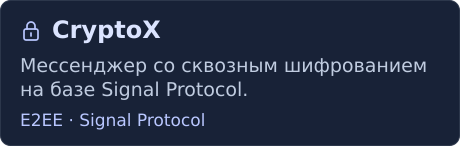
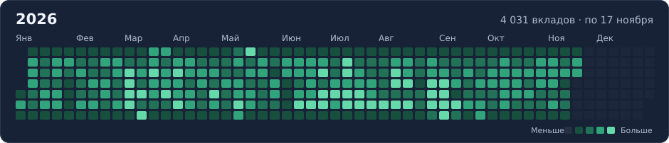

  

## Стек

<picture>
  <source media="(prefers-color-scheme: dark) and (max-width: 680px)" srcset="https://raw.githubusercontent.com/GANSGX/GANSGX/main/assets/stack-dark-mobile.png">
  <source media="(max-width: 680px)" srcset="https://raw.githubusercontent.com/GANSGX/GANSGX/main/assets/stack-light-mobile.png">
  <source media="(prefers-color-scheme: dark)" srcset="https://raw.githubusercontent.com/GANSGX/GANSGX/main/assets/stack-dark.png">
  
</picture>

## Избранные проекты

  
  

  
  

## Активность

